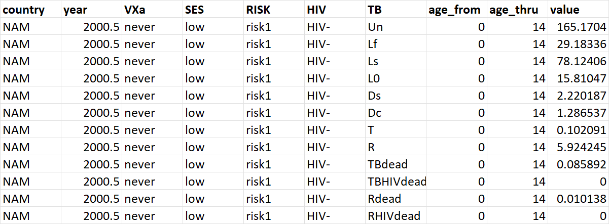
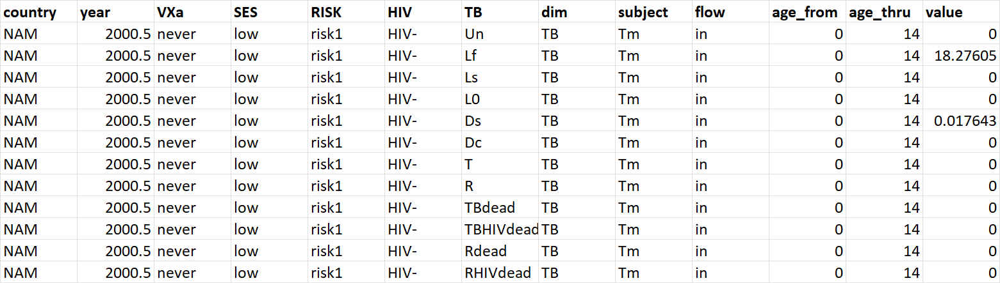

### Overview

Here, we briefly describe and document the output and evaluation of output versus predefined targets.

The main model output consists of

-   stocks: the number of people in a state defined by VXa, SES, RISK, HIV and TB stage) and

-   flows: the number of people moving into a new state or out of the current state per year; inflows are positive and outflows are negative

### Stocks output

Example:

{width="920"}

The stocks output contains for a country the number of people at a moment in time (year) for each combination of states by dimension and for a certain age group.

### Flows output

Example:

{width="1201"}

The flows output contains for a country and moment in time (**year**) and for a certain **dim**ension (e.g. **TB**) the **flow** **in**to (\>=0) or **out** of (\<=0) the state for that dimension (e.g. **Lf**) for a combination of states of other dimensions (that do not change e.g. **never**, **low**, **risk1**, and **HIV-** for dimensions **VXa**, **SES**, **RISK** and **HIV**) due to a specific process (**subject**) and for a certain age group (**age_from** and **age_thru**).

For instance, the 2nd line in the example shows that 18.28 individuals are moving into the **Lf** **TB** state (while in never, low, risk1, and HIV- and age group 0-14) **per year** due to TB transmission (**Tm**)

The meaning of **subject**:

-   **Tm** for mTb transmission

-   **[VXa\|HIV\|TB]Xi** for incidence

-   **[VXa\|HIV\|TB]p** for progression

-   **[VXa\|HIV\|TB]Tr\_** followed by the name of the treatment matrix for treatment (from the XML)\

The generation of output depends on the XML

\<output\>\
\<detailed.output\
years="c(2000, 2005, 2010, 2011, 2015, 2017, 2019, 2020, 2021)+0.5"\
age.group.lower.limits="c(0,15,50)"\
econ.output="false"\
suppress.zeros.in.stocks="false"\
suppress.zeros.in.flows="false"\
combine.stocks.and.flows="false"\> \<flows dim="TB" incidence="true" transmission="true" progression="true" treatment="true"/\>\
\<flows dim="HIV" incidence="true" transmission="false" progression="true" treatment="true"/\>\
\<flows dim="VXa" incidence="true" transmission="false" progression="false" treatment="false"/\> \</detailed.output\>\
\</output\>\
\
with:\
**years** : the time points for output generation

**age.group.lower.limits** : the lower limits of the age groups to generate output for ; in this case output will be generated for age groups 0 thru 14, 15 thru 49, 50 thru 99 ; in addition output will be generated for 0 - 99 by default

**econ.output** : if "true" in addition to output on **stocks**, **flows** and **hits** (only if target specified, see below) additional output will be generated for as detailed in C. Demography.\
\
**suppress.zeros.in.stocks** : if "true", stocks with a value of 0 will be excluded\
\
**suppress.zeros.in.flows** : if "true", flows with a value of 0 will be excluded

**combine.stocks.and.flows** : if "true", stocks and flows will be combined into a single output file [advise: don't use]

The **\<flows\>** sub elements specify for each 'dimension' if flows output will be generated for the various transition types. The attributes of **\<flows\>** :\
\
**dim** : the 'dimension' i.e. either VXa, HIV or TB

**incidence** : option to include incidence flows

**transmission** : option to include TB transmission flows

**progression** : option to include progression flows

**treatment** : option to include flows due to treatment matrices

See below an example of the **stocks** output

on how flows are identified in the output.

### Evaluation of targets

The model output is compared with predefined targets which are provided in a .csv file with a single target per row.

Each target is defined by **country code**, **year**, a numerator (**x**) and a denominator (**y**).

Both numerator and denominator are defined by

-   **VXa**, **SES**, **RISK**, **HIV** and **TB** stage (each either 'all' or a comma separated list of stages)

-   a **type** (stock, inflow or outflow) and

-   a **cause** (NA for stocks, and for flows:

    -   **Tm** for transmission

    -   **[VXa\|HIV\|TB]Xi** for incidence

    -   **[VXa\|HIV\|TB]p** for progression

    -   **[VXa\|HIV\|TB]Tr\_** followed by the name of the treatment matrix for treatment (from the XML)

-   **fn** defines the operation applied to **x** and **y** (x/y for a ratio, 1e5*x/y for incidence per 100K per year)*

-   **age_from** and **age_thru** denote the age group

-   **value**, **lo**, and **hi** denote the target value and lower and upper bounds

### Example

| country | year   | xVXa | xSES | xRISK | xHIV    | xTB       | xtype            | xcause                | yVXa | ySES | yRISK | yHIV | yTB | ytype              | ycause | fn       | age_from | age_thru | value | lo  | hi  | err | name                     | type |
|---------|--------|------|------|-------|---------|-----------|------------------|-----------------------|------|------|-------|------|-----|--------------------|--------|----------|----------|----------|-------|-----|-----|-----|--------------------------|------|
| ZAF     | 2019.5 | all  | all  | all   | all     | Ds        | inflow           | Tm,TBp,TBtr_LfLsRDs   | all  | all  | all   | all  | all | stock              | NA     | 1e5\*x/y | 0        | 99       | 615   | 427 | 835 | 204 | TB_inci_0\_99            | inci |
| ZAF     | 2019.5 | all  | all  | all   | HIVdead | all       | inflow           | HIVp,HIVtr_HIVARTdead | all  | all  | all   | all  | all | stock              | NA     | 1e5\*x/y | 15       | 99       | 1     | 0   | 2   | -1  | HIV_deaths_15_99         | inci |
| ZAF     | 2019.5 | all  | all  | all   | all     | TBHIVdead | inflow           | TBp,TBtr_died         | all  | all  | all   | all  | all | stock              | NA     | 1e5\*x/y | 15       | 99       | 1     | 0   | 2   | -1  | TBHIV_deaths_15_99       | inci |
| ZAF     | 2019.5 |      |      |       |         |           | HIV_deaths_15_99 |                       |      |      |       |      |     | TBHIV_deaths_15_99 |        | x+y      | 15       | 99       | 100   | 50  | 150 | 50  | HIVplusTBHIVdeahts_15_99 | inci |

In the example above, row 1 defines a standard target:

-   the **inflow** into the **Ds** TB state due to TB transmission (**Tm**), TB progression (**TBp**) or the TB treatment (**TBtr**) with treatment matrix name **LfLsRDs** per 100,000 alive population in the age group 0 thru 99

Row 4 defines a combined target i.e. the sum of the two targets defined in rows 2 and 3:

-   for a combined target, the target names are entered in the **xtype**, **xcause**, **ytype** and **ycause** columns whereas the operation (in this case the sum x+y) is entered in the **fn** column ; the variables available in the **fn** are **x**, **a**, **y** and **b** for the target names referred to in the **xtype**, **xcause**, **ytype** and **ycause** columns, respectively.

Entering -1 in the **err** column (rows 2 and 3 in the example) causes the targets defined in those rows to be used as intermediate targets (as a source for combined targets). Intermediate targets do not appear in the output (both the output\$hits element and the [hits].txt file) unless the option exclude.intermediates equals F.

See also the documentation for the functions

-   **get.target.hits(output=NULL,model.params=NULL)** [in TBVx-hi-level-fncs-v#.R] which calls

    -   read.targets() [in TBVx-output-query-fncs-v#.R] and

    -   eval.output.vs.targets() [in TBVx-output-query-fncs-v#.R]
